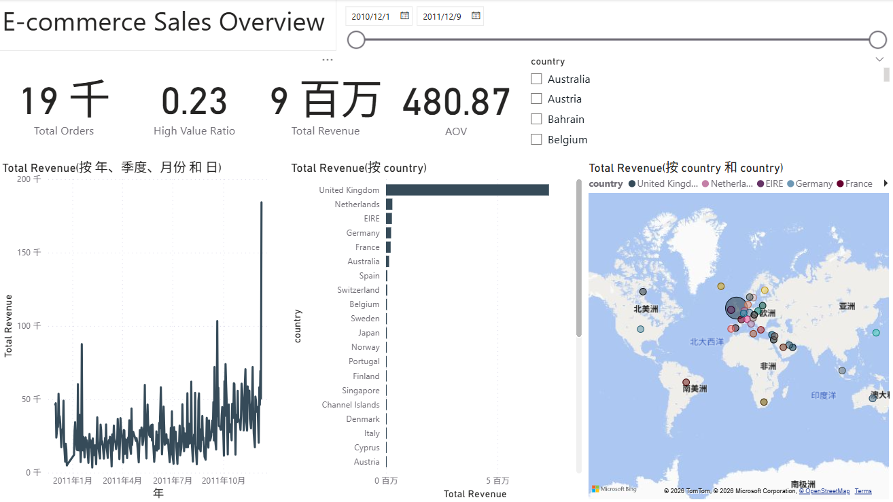
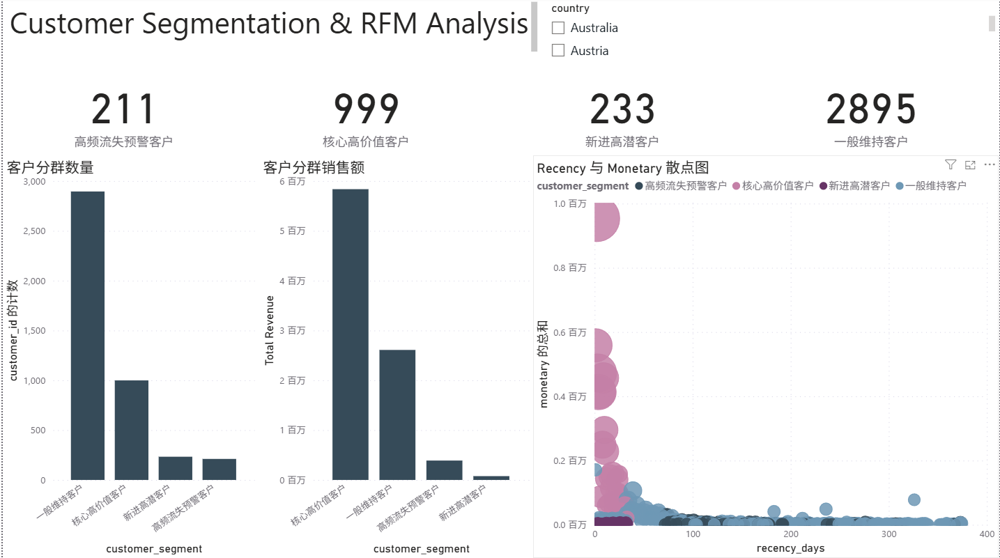

# 电商客户价值分析与销售预测

这是一个面向业务决策的电商客户价值分析项目，覆盖从原始交易数据清洗、MySQL 数据建模、客户 RFM 分群，到 Power BI 仪表板和客户未来消费预测的完整流程。

## 速览

**业务问题：** 如何识别高价值、流失风险和高潜力客户，并预测客户未来 90 天的消费金额，为差异化营销和客户运营提供依据。

**项目价值：** 完成“交易明细 -> 数据模型 -> 客户分群 -> 消费预测 -> 管理看板”的端到端分析闭环，而非仅制作静态报表。

**技术亮点：** 使用规范化 MySQL 三表模型、SQL 窗口函数 RFM 打分、Welch T 检验、基于客户行为特征的回归预测，以及跨时间窗口的 OOT 验证来模拟真实业务中的未来预测。

> 面试展示建议：先阅读本页了解业务问题与核心方法，再打开 Python 分析脚本查看过程，最后下载 PBIX 查看交互式仪表板。

## 数据来源与数据规模

本项目使用公开的 Kaggle `Ecommerce Data` 数据集：

- 来源链接：[Kaggle - Ecommerce Data](https://www.kaggle.com/datasets/carrie1/ecommerce-data)
- 原始文件名：`data.csv`
- 原始数据字段：`InvoiceNo`、`StockCode`、`Description`、`Quantity`、`InvoiceDate`、`UnitPrice`、`CustomerID`、`Country`
- 原始数据规模：541,909 行，8 列
- 清洗后数据规模：397,884 行，9 列
- `CustomerID` 缺失记录：135,080 行
- `Quantity <= 0` 记录：10,624 行
- `UnitPrice <= 0` 记录：2,517 行

清洗规则按顺序执行：删除 `CustomerID` 缺失记录，再删除 `Quantity <= 0` 或 `UnitPrice <= 0` 的记录，最后新增 `TotalAmount` 字段。因此不同异常条件可能命中同一行，异常记录数量不能直接相加。原始 `data.csv` 未上传至本仓库，使用时请从上述 Kaggle 页面获取。数据集的具体许可和使用条件以 Kaggle 页面及其原始数据说明为准。

## 核心亮点

- **端到端数据分析闭环：** 使用 Python、MySQL、SQL 和 Power BI 打通数据处理、分析建模和业务展示，体现完整的数据分析工作流。
- **面向业务的数据治理：** 清洗缺失客户、退货和异常定价记录，并构造 `TotalAmount = Quantity * UnitPrice`，保证后续分析以有效交易为基础。
- **规范化数据建模：** 将交易宽表拆分为 `customers`、`invoices`、`invoice_items` 三张关联表，以主键和外键维护客户、订单、订单明细之间的关系。
- **可落地的客户分群：** 使用 SQL `NTILE(5)` 窗口函数计算 RFM 五分位评分，将客户映射为核心高价值、流失预警、新进高潜和一般维持四类客群。
- **统计推断而非仅看图表：** 使用 Welch 独立样本 T 检验，判断英国本土和海外市场的交易明细平均金额差异是否具有统计显著性。
- **避免时间泄漏的预测验证：** 以 Recency、Frequency、历史消费、客单价等特征预测未来 90 天消费金额，并采用跨时间窗口 OOT 验证评估模型对未来数据的泛化能力。
- **可供业务人员使用的交付：** 使用 Power BI 呈现销售表现、国家分布、客户分层与预测结果，支持客户运营和营销资源分配。

## 分析结果

### 数据清洗

| 指标 | 结果 |
|---|---:|
| 原始数据量 | 541,909 行，8 列 |
| `CustomerID` 缺失记录 | 135,080 行 |
| `Quantity <= 0` 记录 | 10,624 行 |
| `UnitPrice <= 0` 记录 | 2,517 行 |
| 清洗后数据量 | 397,884 行，9 列 |

### 国家销售额

清洗后数据中，销售额最高的国家为英国，销售额约为 **£7,308,391.55**。前五名如下：

| 排名 | 国家 | 销售额 |
|---:|---|---:|
| 1 | United Kingdom | £7,308,391.55 |
| 2 | Netherlands | £285,446.34 |
| 3 | EIRE | £265,545.90 |
| 4 | Germany | £228,867.14 |
| 5 | France | £209,024.05 |

### 英国与海外市场差异检验

当前脚本对清洗后的**交易明细金额**进行 Welch 独立样本 T 检验：

| 指标 | 结果 |
|---|---:|
| 英国交易明细平均金额 | £20.63 |
| 海外交易明细平均金额 | £36.80 |
| T 统计量 | -23.4680 |
| p-value | 1.1938e-121 |

由于 p-value 小于 0.05，拒绝两组均值相等的原假设。结果表明，在当前交易明细口径下，英国与海外市场的平均金额存在统计显著差异。**这不能直接解释为订单客单价差异；若要分析客单价，应先按 `InvoiceNo` 汇总每笔订单金额后重新检验。**

### RFM 客户分群

| 客户类型 | 客户数量 |
|---|---:|
| 一般维持客户 | 2,895 |
| 核心高价值客户 | 999 |
| 新进高潜客户 | 233 |
| 高频流失预警客户 | 211 |
| **合计** | **4,338** |

### 未来 90 天消费预测

模型使用跨时间窗口 OOT 验证：训练集为 2,718 个客户，测试集为 2,813 个客户。

| 指标 | 结果 |
|---|---:|
| OOT 对数空间 R² | 0.1689 |
| 原始金额空间 MAE | £873.52 |

回归系数按从高到低排序：`frequency` 1.104589、`total_spend` 0.787959、`total_qty` 0.296545、`recency` -0.004282、`avg_order_value` -0.345350。模型作为基线模型具有一定解释性，但预测能力仍有限，应结合其他模型和业务基准继续评估。

## 技术栈

`Python` `Pandas` `NumPy` `SciPy` `scikit-learn` `Seaborn` `MySQL` `SQLAlchemy` `Power BI`

## Power BI 预览

目前已完成两个 Power BI 页面：销售总览，以及客户分群与 RFM 分析。GitHub 无法直接渲染 PBIX，因此以下截图用于快速预览，完整交互文件请下载 PBIX。

### 1. 销售总览



### 2. 客户分群与 RFM 分析

页面包含 `Country` 国家筛选器、四类客户群体数量指标、客户分群销售额条形图、客户分群数量条形图，以及 `Recency` 与 `Monetary` 客户价值散点图。该页面用于从客户规模、销售贡献和客户价值分布三个角度支持客户运营分析。



## 仓库结构

```text
.
├── scripts/
│   └── 01_data_cleaning_and_modeling.py       # 清洗、统计检验、特征工程、回归预测
├── sql/
│   ├── 01_create_schema.sql                 # 数据库及三张核心表
│   └── 02_customer_rfm.sql                  # RFM 视图与客户分群规则
├── powerbi/
│   ├── ecommerce_customer_dashboard.pbix       # Power BI 可视化文件
│   ├── sales_overview.png                      # 销售总览截图
│   └── customer_segmentation_rfm.png           # 客户分群截图
├── docs/
│   ├── PROJECT_OVERVIEW.md                  # 面试讲解提纲与业务口径
│   └── DATA_DICTIONARY.md                   # 字段定义和清洗口径
├── requirements.txt
├── .gitignore
└── .gitattributes
```

## 分析流程

```text
原始交易数据
    -> Python 清洗与指标构造
    -> MySQL 维度/事实表
    -> SQL RFM 客户分群
    -> Power BI 销售与客户画像看板
    -> Python 特征工程与未来 90 天消费预测
```

## 快速开始

### 1. 准备数据

请将下载后的原始文件放入仓库根目录的 `data/data.csv`。`data/` 已被 `.gitignore` 忽略，不会上传原始数据。数据至少需要包含：`CustomerID`、`InvoiceNo`、`InvoiceDate`、`StockCode`、`Description`、`Quantity`、`UnitPrice`、`Country`。

### 2. 安装 Python 依赖

```bash
python -m venv .venv
# Windows
.venv\\Scripts\\activate
# macOS / Linux
# source .venv/bin/activate
pip install -r requirements.txt
```

运行 `scripts/01_data_cleaning_and_modeling.py` 可执行清洗、统计分析和特征工程部分；数据库导入部分需要先配置 MySQL 环境变量后再执行。由于脚本包含多个分析阶段，建议在 IDE 或 Jupyter 中按代码标题分段运行，而不是在没有数据和数据库的环境中直接一键运行。脚本默认从 `data/data.csv` 读取数据。

### 3. 创建 MySQL 数据库

先执行 `sql/01_create_schema.sql`，然后运行 Python 脚本中的数据库导入部分。数据库凭据通过环境变量配置：

```powershell
$env:MYSQL_USER = "root"
$env:MYSQL_PASSWORD = "your-password"
$env:MYSQL_HOST = "localhost"
$env:MYSQL_PORT = "3306"
$env:MYSQL_DATABASE = "ecommerce_db"
```

最后执行 `sql/02_customer_rfm.sql`，生成 `view_customer_rfm` 视图。若只运行清洗和建模部分，可以不配置 MySQL；若运行数据库导入部分，则必须配置 `MYSQL_PASSWORD`。

### 4. 查看 Power BI

用 Power BI Desktop 打开 `powerbi/ecommerce_customer_dashboard.pbix`。当前报告已完成两个页面：销售总览、客户分群与 RFM 分析。GitHub 网页不能直接渲染 PBIX，因此 README 中提供了页面截图作为快速预览，PBIX 作为下载和交互查看入口。预测模型已在 Python 脚本中完成，尚未单独制作预测可视化页面。

**公开上传前请在 Power BI Desktop 中检查：** 删除或替换本机文件路径、数据库服务器地址、用户名、密码和私人数据；清除数据源凭据；确认客户编号、订单明细和导出数据不包含不应公开的个人信息。保存一个仅包含脱敏或公开样例数据的版本后再上传。

## 结果解读

项目输出包括：国家销售额排名、英国与海外交易明细金额差异检验、客户 RFM 分群、未来 90 天消费金额预测、模型 OOT 验证指标及回归系数。具体数值会随数据版本和 Power BI 刷新状态变化，应以 Python 输出和 PBIX 的实际结果为准。

## 公开上传前检查

- 确认 `data/`、`.env`、数据库导出文件和本地配置没有被提交。
- 确认 PBIX 中没有本机路径、数据库凭据、私人数据或未授权的数据集。
- 在 GitHub 页面检查 README、SQL 和 Python 文件是否能正常阅读；不要只依赖本地文件可打开。
- 如果使用 Power BI Service 链接，确认链接权限和数据范围适合公开分享。
- 若数据来自第三方公开数据集，在 README 中补充数据集名称、来源和许可信息。

原始数据、数据库密码、个人路径和其他本地配置不应提交到公开仓库。本项目 Python 脚本已改为从环境变量读取数据库密码；请不要把真实密码写回代码。
